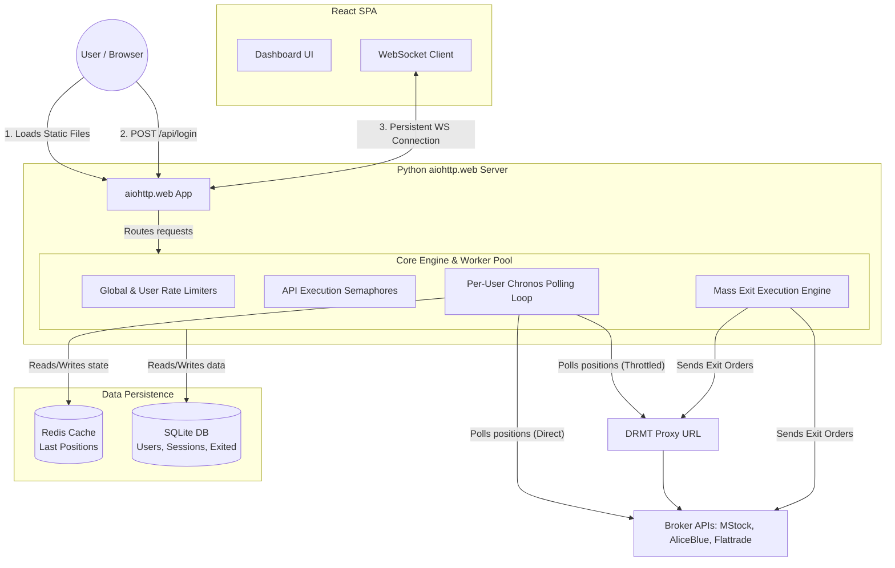

# DRMT V2: End-to-End System Architecture

This document outlines the complete data flow, architecture, and user journey of your DRMT V2 system after implementing the **Chronos Engine** migration plan using `aiohttp.web`, `asyncio`, Redis, and SQLite.

---

## 1. High-Level Architecture Diagram



---

## 2. Step-by-Step User & Data Flow

### Step 1: System Startup
1. **Boot:** The `main.py` script starts the `aiohttp.web` application.
2. **Initialization:** The application lifespan boots the **Core Engine**. 
3. **Connection Pools:** The Core Engine establishes a global `aiohttp.ClientSession` pool (capped at 50 connections to prevent port exhaustion), a connection pool to **SQLite**, and a connection pool to **Redis**.
4. **Caching:** The Execution Engine fetches and caches the `OpenAPIScripMaster` (MStock instruments).
5. **Serving UI:** The server is now ready, serving your React SPA HTML/JS/CSS files directly from memory via static routes.

### Step 2: User Authentication
1. **Login Request:** The user enters credentials on the React frontend. The browser sends a `POST /api/login` request.
2. **Validation:** The backend validates the password (using bcrypt/SHA256/AES-CBC depending on the broker) against the SQLite database.
3. **Session Creation:** On success, the backend sets an `HttpOnly`, `SameSite=Strict` cookie (`drmt_session`) and returns success.

### Step 3: The Chronos Engine (Live Position Streaming)
This is where the magic of the **Chronos Engine** happens.

1. **WebSocket Handshake:** The React frontend opens a persistent WebSocket connection to `GET /ws/positions`.
2. **Auth & Setup:** The backend reads the secure cookie, validates the user, and the Core Engine spawns a dedicated async task (`spawn_user`) just for this user.
3. **Instant Redis Restore:** Before making any slow broker calls, the backend immediately checks **Redis** for this user's last known positions and pushes them to the WebSocket. *Result: The user sees their positions instantly, even on a page refresh.*
4. **The `while True` Loop:**
    * **Jitter:** The loop sleeps for a random fraction of a second (0-1s) to prevent a "thundering herd" if 500 users reconnect at once.
    * **Poll:** It acquires a token from the **Rate Limiter**, then fetches live data from the broker.
    * **Diff Before Push:** It compares the fresh broker data with the data currently in Redis.
    * **Push:** *If* the data changed, it sends the new JSON down the WebSocket to React. If nothing changed, it stays silent (saving bandwidth and frontend CPU).
    * **Cache:** It overwrites the Redis cache with the new state.
    * **Cooldown:** It executes `await asyncio.sleep(1)`. This guarantees strict non-overlapping polls.
5. **Zombie Protection:** The React frontend sends a `{"type": "ping"}` message every 15 seconds. If the backend loop goes 30 seconds without receiving a ping, it assumes the user closed their laptop, cancels the `while True` loop, and frees the resources.

### Step 4: Mass Exit Execution
1. **User Action:** The user clicks "Exit All" on the React dashboard.
2. **API Call:** A `POST /api/positions/exit` request is sent.
3. **Core Engine Throttling:** The exit request does *not* execute immediately. It enters the Core Engine and must acquire the global `Semaphore(20)`. This guarantees you never overwhelm the broker APIs with too many simultaneous orders.
4. **Dispatch:** The Execution Engine maps the product types (e.g., NFO to CARRYFORWARD) and sends the specific order payload to the broker (via Proxy for MStock/Flattrade, or direct for AliceBlue).
5. **Record Keeping:** Once successful, the engine records the exit details (Price, PnL, IST timestamp) into the `exited_positions` SQLite table.

---

## 3. Affected Components & Directory Structure

Here is how the codebase will be organized to support this flow:

```text
/opt/drmt/drmt/drmt_python/
├── main.py                 # aiohttp.web app setup, lifespan, static file serving
├── settings.py             # pydantic-settings config (RPS limits, DB paths)
├── core/
│   └── engine.py           # CoreEngine class: RateLimiters, Semaphores, Task/Pool manager
├── api/
│   ├── auth.py             # Login/Logout REST handlers
│   ├── websocket.py        # /ws/positions endpoint (bridges to Chronos loop)
│   └── exit_routes.py      # Mass exit REST handlers & filters
├── position/
│   ├── chronos.py          # The 'while True' polling loop, Diffing, and Redis logic
│   ├── mstock.py           # Broker-specific API parsers
│   ├── aliceblue.py
│   └── flattrade.py
├── execution/
│   ├── engine.py           # Order payload mapping and dispatch
│   └── instruments.py      # Scrip master caching
├── credentials/
│   ├── httpclient.py       # Aiohttp proxy wrapper (strips X-Static-IP)
│   ├── crypto.py           # AES-CBC, SHA256, TOTP helpers
│   └── dedup.py            # UPSERT logic for token management
├── database/
│   └── db.py               # aiosqlite connection pool and migrations
└── models/
    └── schemas.py          # Pydantic data validation models
```

---

## 4. Why This Architecture is Bulletproof

1. **No Front-End Overload:** The React frontend does zero polling. It just listens. CPU and network usage on the client's device will be near zero.
2. **Broker IP Protection:** The two-tiered Token Bucket rate limiter inside `core/engine.py` guarantees that your server will *never* send more than 50 requests per second to the broker, absolutely preventing IP bans.
3. **Memory Safety:** By utilizing a single `aiohttp.ClientSession` pool and strictly bounded `asyncio.Queue` workers, the system will never exhaust Linux ephemeral TCP ports or run out of RAM, even with 500+ concurrent users.
4. **Resilience to Broker Outages:** The `while True` loop wraps the broker API calls in strict `try/except` blocks. If a broker returns a 502 Bad Gateway (HTML instead of JSON), the loop simply logs the error, sleeps for 1 second, and tries again. The system will never crash.
